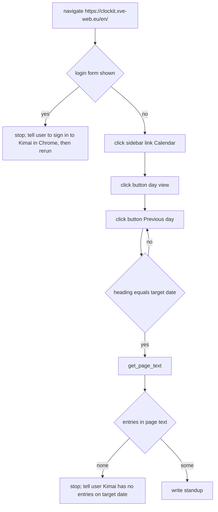

Read-only in Kimai and Teams: never click a Kimai entry, `Start time-tracking`, `Restart one of your last activities`, `Create`, `Edit` or `Delete`; never post, send or paste into Teams or any chat.

Today = output of `date '+%F %u'` (date, weekday 1 = Monday). Weekday 1 -> target date = today minus 3 days, label `Friday:`; else target date = today minus 1 day, label `Yesterday:`.

Before first browser call: load `mcp__claude-in-chrome__tabs_context_mcp`, `mcp__claude-in-chrome__tabs_create_mcp`, `mcp__claude-in-chrome__navigate`, `mcp__claude-in-chrome__find`, `mcp__claude-in-chrome__computer`, `mcp__claude-in-chrome__get_page_text`, `mcp__claude-in-chrome__tabs_close_mcp` in one ToolSearch `select:` call.

Before navigating: `tabs_context_mcp`, then `tabs_create_mcp`; work only in that new tab; resolve link `Calendar`, button `day view`, button `Previous day` with `find`, click with `computer` `left_click` on the returned ref.



Heading above calendar shows shown date as `Month D, YYYY`, e.g. `November 24, 2026`; more than 7 `Previous day` clicks -> stop and report heading.

Before final answer, including every stop: close tab with `tabs_close_mcp`.

Entry = line following a `H:MM - H:MM` line in page text; ignore text before date heading because `Restart one of your last activities` lists activities, not entries; page order is not time order and times carry no am/pm, so ignore times.

Jira key = match of `[A-Za-z]+-[0-9]+`, written uppercase. Entry's key = first Jira key in its text, because later keys in a title are cited tickets; key list entry (only action words and keys, e.g. `deploy GDW-1871, GDW-1872, GDW-1874`) -> every key in it. One output line per key across all entries, in order of first appearance in page text.

Line = `<KEY> <summary>`; summary = Dutch, 2 to 6 words, naming ticket subject taken from that key's entries other than key list entries, without `[Component]` tags and without action words `deploy`, `deployed`, `prepare deployment`, `finish`, `get metrics for`. Key with only key list entries -> line is key alone.

Any entry for a key contains word `review` (case-insensitive) -> line starts `Review ` and summary omits word `review`.

Entry without Jira key -> one line per distinct entry text, Dutch, at most 6 words; identical texts merge into one line.

Final answer = one fenced code block holding message, nothing else. First line = today as `[DD/MM/YY]`; second line = label; then entry lines; then one empty line; then literal lines `Today`, `Blockers`, `PR` with nothing under them. Literal output:

```
[25/11/26]
Yesterday:
GDW-1650 lading vanuit aankooporder
Review GDW-1873 depotgebruikers verbergen
GDW-1218 Exact boekhouding analyse

Today
Blockers
PR
```
