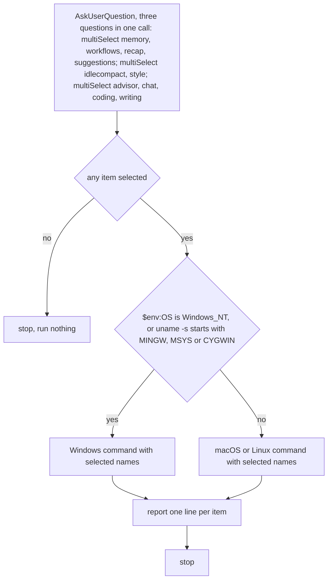

Never write key or rule file for unselected item; unselected items stay untouched, never set to opposite value. Every other settings key stays untouched.

Items, each opt-in, nothing preselected, names exactly as listed. Second question is multi-select over `idlecompact` and `style`. Third question is multi-select over four guideline items.

Item `memory`: sets `autoMemoryEnabled` to false; Claude stops reading and writing auto memory, subagent memory included.

Item `workflows`: sets `disableWorkflows` to true; turns off dynamic workflows and bundled workflow commands.

Item `recap`: sets `awaySummaryEnabled` to false; no one-line recap on return to terminal.

Item `suggestions`: sets `promptSuggestionEnabled` to false; no grayed-out predictions in prompt.

Item `idlecompact`: sets `idleCompaction` to false; Claude Code stops compacting long conversation while terminal session sits idle. Key needs Claude Code 2.1.290 or later.

Item `style`: sets `outputStyle` to `starter:ultra-concise`, output style this plugin ships; fragments, result first, tables and diagrams over prose, no preamble or recap; errors, warnings, destructive confirmations keep full detail. Applies to main conversation, not to other subagents.

Item `advisor`: installs rule file `starter-advisor.md`; advisor checkpoints, decisive thinking, compaction survival.

Item `chat`: installs rule file `starter-chat.md`; TL;DR user-facing messages, questions only at bottom.

Item `coding`: installs rule file `starter-coding.md`; think before coding, simplicity, surgical changes, goal-driven work, review mindset.

Item `writing`: installs rule file `starter-writing.md`; human prose with banned-word list, written artifacts only (commit messages, PR descriptions, READMEs, docs, code comments).

Target is `settings.json` and `rules/` in `CLAUDE_CONFIG_DIR`, else `~/.claude`; `rules/` is user-level rules folder, loaded every session at launch. Selected settings item overwrites existing value of its key. Script backs up `settings.json` to `settings.json.bak.<timestamp>` before first write, writes nothing when every selected key already holds its value, creates file when missing, exits 1 naming file on invalid JSON object. Rule item copies its asset as LF; differing existing file is backed up as `starter-NAME.md.bak.<timestamp>`, which never loads because it does not end in `.md`. `CLAUDE.md` holding `core:guidelines` fence -> script skips every rule item.

Windows command: `powershell -NoProfile -ExecutionPolicy Bypass -File "${CLAUDE_SKILL_DIR}/scripts/setup.ps1"` followed by selected names, space-separated.

macOS or Linux command: `sh "${CLAUDE_SKILL_DIR}/scripts/setup.sh"` followed by selected names, space-separated; settings items need `python3`.

Script prints `created PATH`, `backup PATH`, `written KEY=VALUE`, `already KEY=VALUE`, `written rule PATH`, `already rule PATH`, `skipped rules: ...`. Line starting `invalid JSON object`, `missing asset` or `needs python3` -> relay verbatim, stop.

After script: report per selected item written or already held; list unselected items as untouched; quote backup paths.

After `skipped rules`: tell user `CLAUDE.md` already holds core guidelines, so no rule file was written.

After rule item written: tell user each rule file costs input tokens every session (about 350 advisor, 170 chat, 320 coding, 270 writing), loads from next session, and deleting `rules/starter-NAME.md` removes it.

After `idlecompact` written or held: tell user first message after prompt cache expires (about one hour idle) now resends whole conversation uncached, and `/compact` and auto-compact still work.

After `style` written or held: tell user `/output-style` lists it as `starter:ultra-concise`, it loads only while this plugin is enabled, and project settings override user scope.

After `memory` written or held: tell user repository settings file overrides user scope when it sets `autoMemoryEnabled`, and existing memory files stay on disk unloaded.

After any settings write: tell user running sessions reload settings on save; `/status` shows loaded sources and `claude doctor` lists rejected entries.
