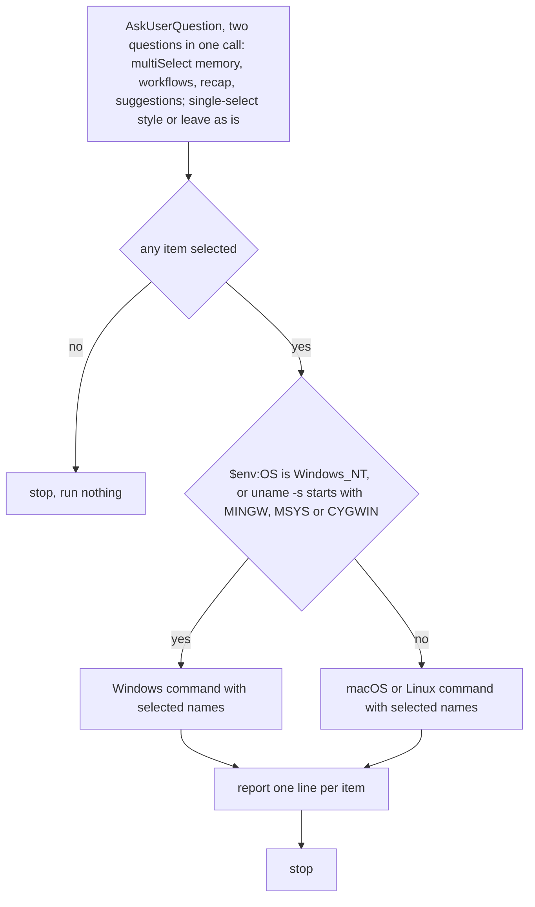

Never write key for unselected item; unselected items stay untouched, never set to opposite value. Every other settings key stays untouched.

Items, each opt-in, nothing preselected, names exactly as listed. Second question is single-select with options `style` and `leave as is`; neither marked recommended.

Item `memory`: sets `autoMemoryEnabled` to false; Claude stops reading and writing auto memory, subagent memory included.

Item `workflows`: sets `disableWorkflows` to true; turns off dynamic workflows and bundled workflow commands.

Item `recap`: sets `awaySummaryEnabled` to false; no one-line recap on return to terminal.

Item `suggestions`: sets `promptSuggestionEnabled` to false; no grayed-out predictions in prompt.

Item `style`: sets `outputStyle` to `starter:ultra-concise`, output style this plugin ships; fragments, result first, no preamble or recap; errors, warnings, destructive confirmations keep full detail. Applies to main conversation, not to other subagents.

Target is `settings.json` in `CLAUDE_CONFIG_DIR`, else `~/.claude`. Selected item overwrites existing value of its key. Script backs up to `settings.json.bak.<timestamp>` before first write, writes nothing when every selected key already holds its value, creates file when missing, exits 1 naming file on invalid JSON object.

Windows command: `powershell -NoProfile -ExecutionPolicy Bypass -File "${CLAUDE_SKILL_DIR}/scripts/setup.ps1"` followed by selected names, space-separated.

macOS or Linux command: `sh "${CLAUDE_SKILL_DIR}/scripts/setup.sh"` followed by selected names, space-separated; needs `python3`.

Script prints `created PATH`, `backup PATH`, `written KEY=VALUE`, `already KEY=VALUE`. Line starting `invalid JSON object` or `needs python3` -> relay verbatim, stop.

After script: report per selected item written or already held; list unselected items as untouched; quote backup path.

After `style` written or held: tell user `/output-style` lists it as `starter:ultra-concise`, it loads only while this plugin is enabled, and project settings override user scope.

After `memory` written or held: tell user repository settings file overrides user scope when it sets `autoMemoryEnabled`, and existing memory files stay on disk unloaded.

After any write: tell user running sessions reload settings on save; `/status` shows loaded sources and `claude doctor` lists rejected entries.
